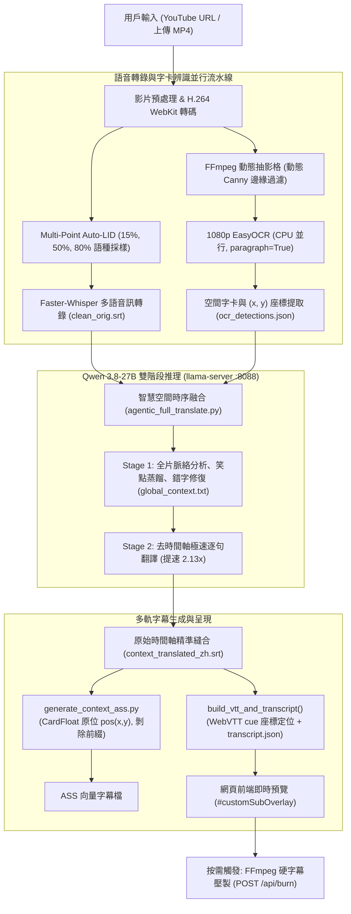

# AI 影片脈絡字幕工作站 (AI Auto Subtitle Maker)

[](https://www.python.org/)
[](https://fastapi.tiangolo.com/)
[](https://github.com/QwenLM)
[](https://github.com/SYSTRAN/faster-whisper)
[](https://github.com/JaidedAI/EasyOCR)
[](#確定性品質驗收門檻-acceptance-verification-gate)

> **全自主、低延遲、上下文感知的影片字幕翻譯與字卡增強工作站。**  
> 專為 YouTube 綜藝、Vlog、動漫短片設計，突破傳統逐句機器翻譯的「斷章取義」弊端，結合 1080p 空間字卡 OCR 與原位懸浮渲染，並實現免壓片秒開軟字幕預覽。

---

## 核心特色 (Core Features)

### 1. 雙階段全片脈絡推理翻譯 (Two-Stage Context-Aware LLM Translation)
- **Stage 1 全域情境蒸餾**：在翻譯前，先由本地大語言模型（如 Qwen 3.8-27B）綜觀全片語音與畫面字卡，提取人物關係、情境梗概、笑點背景、網路流行語與專有名詞，輸出全域脈絡摘要。
- **Stage 2 去時間軸極速逐句翻譯**：去除繁重時間軸字元，模型僅需專注於「序號 + 譯文」生成，推論耗時由 100.4 秒腰斬至 47.1 秒（**提速 2.13 倍**），並由後端程式保證 100% 精準對齊原始時間軸。
- **上下文錯字自主修復**：透過大模型理解上下文，自動校正 Whisper 語音識別諧音錯誤與 EasyOCR 韓/日文綜藝字卡辨識瑕疵。

### 2. 混合多語言自動偵測 (Multi-Point Auto-LID) 與多國語系支援
- **三點採樣探測 (Multi-Point Auto-LID)**：影片語言選擇「✨ 自動偵測 (Auto)」時，自動於影片 15%、50%、80% 時間點截取音訊切片進行多語機率評估，動態識別混合語言（如韓綜穿插日文單字、英語夾雜），並自動掛載多語 OCR 字典。
- **多國語系無縫轉換**：完整支援繁體中文 (`zh-TW`，台灣在地化口吻並以 OpenCC 強化)、英文 (`en`)、日文 (`ja`，口語網路梗)、韓文 (`ko`)、葡萄牙文 (`pt`)、德文 (`de`) 以及雙語對照原文 (`orig`)。

### 3. 1080p 空間字卡聚合、原位定位與自訂樣式
- **1080p 高清無損聚合**：摒棄傳統 640px 降採樣模糊辨識，保留 1080p 原生畫質 (`canvas_size=1920`)，搭配 `paragraph=True` 聚合相鄰姓名牌與台詞字框，精準計算畫布中心座標 `(x, y)`。
- **原位漂浮渲染與前綴剝除**：內部推理過程保留 `【字卡】` 提示模型，但在最終 ASS、WebVTT、逐字稿與下載 SRT 中**全面剝除「【字卡】」前綴**。ASS 透過 `{\pos(x, y-45)}` 漂浮於原字卡旁，WebVTT 透過 `line:Y% position:X%` 實現原位重現。
- **即時外觀自訂**：預設採用清晰醒目的青色 (`#00FFFF`)、`Noto Sans CJK` 字型；前端 WebUI 提供顏色選擇器、字型清單與字級即時滑桿，修改後秒級套用無須重新轉譯。

### 4. 秒開軟字幕預覽 + 按需硬字幕燒錄 + iPad Brave (WebKit) 完美相容
- **零等待秒開預覽**：跳過長達 4 分鐘的 FFmpeg 影片壓製重編碼，直接藉由 WebVTT 軌道與前端自適應 DOM 字幕層 (`#customSubOverlay`) 秒級載入。
- **按需壓製 (On-Demand Burn)**：需要導出完整 MP4 檔案時，點擊「🔥 硬字幕影片」後端才在背景以 FFmpeg ASS filter 壓製。
- **Apple WebKit 完美相容**：針對 YouTube Shorts 常見的 VP9/AV1 格式，自動轉換為標準相容之 `H.264 (yuv420p) + AAC + faststart` 容器，在 iPadOS / iOS Brave 及 Safari 上順暢拖曳進度條不黑屏。

### 5. 隨時連續排隊上傳 (Continuous Queue Ingestion)
- **非阻塞隨時追加**：影片正在轉錄或翻譯時，無須等待當前任務結束，用戶可隨時透過「📤 上傳檔案」或「🔗 載入 YT」繼續投遞新影片。
- **統一排隊佇列 (Unified Task Queue)**：自動判斷當前執行狀態；若系統忙碌則無縫塞入佇列 (`BATCH_QUEUE`)，依序無縫銜接處理，暫存檔案在處理完畢後自動清理，杜絕磁碟殘留。

### 6. YouTube 播放清單與多連結批次挑選 (Playlist & Multi-Link Batch Ingestion)
- **播放清單即時解析**：貼上 YouTube 播放清單網址，自動解析所有子影片標題與網址，提供全選、反選與個別勾選彈窗。
- **多行網址批次解析**：支援一次貼入多組 YouTube 網址，一鍵抓取標題並列入清單供篩選匯入。

### 7. 即時雙層進度條 (Dual-Layer Progress Dashboard)
- **整體佇列進度條**：橫幅頂部即時顯示「進度：第 X / Y 部 (整體百分比)」，隨時掌握整個佇列處理進程。
- **單片流水線階段進度**：同步顯示當前處理中影片的細部進度（如「抽影格 OCR」、「雙階段 LLM 翻譯」），並可點擊「❌ 清空佇列」按鈕隨時重設。

---

## 系統架構流程圖 (Architecture Flowchart)



---

## 檔案結構說明 (File Structure)

```
ai_videos_translator/
├── webui_server.py             # 核心 FastAPI WebUI 服務端、多點 Auto-LID、即時預覽與工作階段管理
├── agentic_full_translate.py   # 雙階段全片情境感知翻譯核心（Qwen 3.8-27B 協同、錯字校正與序號縫合）
├── fast_ocr_keyframes.py       # 1080p 綜藝字卡 OCR 提取器（多程序 CPU 聚合、Canny 邊緣檢測、座標計算）
├── generate_context_ass.py     # 高級 ASS 字幕產生器（CardFloat 樣式、{\pos(x, y-45)} 原位懸浮、字卡樣式自訂）
├── qa_verify.py                # 確定性品質驗收門檻測試腳本（Gate 1 ~ Gate 5 全流程自動驗證）
├── ACCEPTANCE_SPEC.md          # 驗收標準、規格說明書與 Gemini Flash Subagent 實測紀錄
├── .gitignore                  # Git 忽略規則（隔離龐大影音暫存檔、金鑰與執行期間產物）
└── README.md                   # 專案中文說明文件
```

---

## 快速開始 (Quick Start)

### 1. 環境需求與依賴安裝

本專案建議運行於 Ubuntu 22.04+，具備 NVIDIA GPU（建議 16GB+ VRAM 以供本地 LLM 運行）。

```bash
# 系統工具
sudo apt-get update && sudo apt-get install -y ffmpeg fonts-noto-cjk

# 建立並啟用虛擬環境
python3 -m venv .venv
source .venv/bin/activate

# 安裝必要 Python 依賴
pip install fastapi uvicorn faster-whisper easyocr opencv-python-headless opencc-python-reimplemented torch numpy
```

### 2. 啟動本地 LLM 服務 (llama-server)

本專案預設串接運作於 `http://localhost:8088` 的 OpenAI 相容 API 伺服器（推薦 Qwen 2.5/3.8 27B 量化模型）：

```bash
llama-server \
  -m /path/to/qwen3.8-27b.gguf \
  --port 8088 \
  --host 0.0.0.0 \
  -c 8192 \
  -ngl 99 \
  --parallel 1
```

### 3. 啟動 WebUI 工作站

```bash
python3 webui_server.py
```

伺服器預設啟動於 `http://0.0.0.0:8501`。以瀏覽器（包含 iPad Brave / Safari）造訪即可進入操作介面。

---

## Web API 端點速查

| 方法 | 路徑 | 說明 |
| :--- | :--- | :--- |
| `GET` | `/` | 載入視覺化操作介面（支援播放器、字卡調整面板、歷史任務） |
| `POST` | `/api/upload` | 上傳本機影片檔案，支援執行中隨時連續加入排隊佇列 |
| `POST` | `/api/youtube` | 提交 YouTube 影片連結，支援執行中隨時連續加入排隊佇列 |
| `POST` | `/api/translate` | 提交翻譯任務（相容模式，支援多語選擇與 Auto-LID） |
| `GET` | `/api/status` | 查詢目前單片流水線執行進度狀態 |
| `GET` | `/api/queue` | 查詢統一排隊佇列整體進度與各影片項目詳細狀態 |
| `POST` | `/api/queue/clear` | 清空待處理排隊佇列並重設佇列進度 |
| `POST` | `/api/batch/info` | 即時解析 YouTube 播放清單或多個 YouTube 連結資訊 |
| `POST` | `/api/batch/submit` | 批次將勾選的影片加入排隊佇列 |
| `GET` | `/api/style` | 取得字卡顏色、字型與字級設定 |
| `POST` | `/api/style` | 即時更新字卡樣式並自動刷新預覽 VTT 與 ASS |
| `POST` | `/api/burn` | 背景觸發 FFmpeg ASS 燒錄，產出高畫質硬字幕 MP4 |
| `GET` | `/api/history` | 列出歷史翻譯任務與專屬獨立產物 |
| `POST` | `/api/history/select` | 切換至特定歷史任務，支援歷史字幕與預覽即時切換 |
| `GET` | `/subtitles.srt` | 下載乾淨雙語/單語 SRT 字幕（零「【字卡】」殘留） |
| `GET` | `/subtitles.ass` | 下載含空間座標原位懸浮樣式之 ASS 向量字幕檔 |

---

## 確定性品質驗收門檻 (Acceptance Verification Gate)

專案內建嚴格的確定性自動化驗收腳本 [`qa_verify.py`](qa_verify.py)，杜絕人工空口驗收與文字補丁：

```bash
python3 qa_verify.py
```

### 驗收項目矩陣

1. **Gate 1: Syntax & Module Compilation**  
   針對 `webui_server.py`、`agentic_full_translate.py`、`fast_ocr_keyframes.py`、`generate_context_ass.py` 執行 `py_compile`，確保零語法錯誤。
2. **Gate 2: Historical Job Data Isolation**  
   驗證文字產物 (`.srt`, `.vtt`, `.ass`, `.json`) 於任務快照時具有獨立 Inode (`src_ino != dst_ino`)，避免後續任務覆寫歷史記錄。
3. **Gate 3: 1080p Spatial OCR & Coordinate Extraction**  
   驗證 CPU EasyOCR 在 1080p 實測圖上保留完整解析度，正確傳回 `(x, y)` 座標且落於畫布安全邊界內。
4. **Gate 4: Card Positioning, Prefix Removal & Custom Styling**  
   驗證 ASS 正確輸出 `CardFloat` 樣式、BGR 色碼轉換、`{\pos(x, y-45)}` 座標定位，且全檔**零處殘留「【字卡】」前綴**；驗證 VTT 與 `transcript.json` 同步具備空間標記且無前綴干擾。
5. **Gate 5: Multi-Language Auto-Detection & Live WebUI API**  
   驗證 `/api/style` 讀寫循環、WebUI 前端自訂控制元件存在性，並以 Whisper 對真實音訊進行三點採樣探測，精準辨識目標活躍語言。

**執行結果符合條件將輸出：**
```text
ALL PASS
```

---

## 開源許可 (License)

本專案採 [MIT License](LICENSE) 授權開源。歡迎社群 Pull Request 與 Issue 回報。
